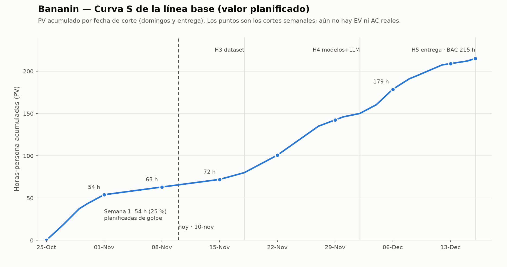

# Bananin — Línea base para el seguimiento con Valor Ganado (EVM)

> **Entregable 1 del codelab «Seguimiento de Proyectos con EVM»** (WBS con % del BAC, cronograma con fechas, BAC definido y justificado, PV acumulado por semana) y **Paso 1 del codelab «Saberlo a Tiempo»** (alcance + tiempo + costo).
>
> Estado: **PROPUESTA lista para aprobar.** Todo lo que sale del repositorio está citado; lo que es decisión mía de reparto está marcado como **supuesto**. La línea base se congela cuando el equipo y el patrocinador la aprueban (ver §7).

Fuentes usadas: `Cronograma.md`, `Criterios de Planificacion.md`, `Presupuesto.md`, `EDT_Bananin_criterios_RACI.md`, `Requisitos.md`, `Acta de constitución del proyecto.md`, `Calidad.md`.

---

## 1. BAC: unidad y justificación

| Campo | Valor | Justificación |
|---|---|---|
| **Unidad** | Horas-persona | El codelab acepta horas, pesos o puntos. El plan del repositorio está en horas; el trabajo real (AC) también se puede registrar en horas sin fricción. |
| **BAC** | **215 horas-persona** | Es la «Distribución propuesta del esfuerzo» del `Cronograma.md`: 40 + 40 + 40 + 30 + 25 + 20 + 20 = 215. |
| **Ventana** | 26-oct-2026 → 16-dic-2026 | Fechas del `Cronograma.md` (≈ 7,4 semanas). |
| **Presupuesto en dinero** | $163.232 COP (estimado) | `Presupuesto.md`. No entra al BAC; se controla aparte (§6). |

> ⚠️ **Dato a confirmar:** el `Cronograma.md` aún tiene texto residual de una conversación («Perfecto. Cambiamos Hardware… de 32 a 10 horas», «107 horas», «296 horas»). El único total coherente con su tabla final es **215 h**. Usé 215. Ver `00_LEEME_Hallazgos_y_Pendientes.md`.

---

## 2. Línea base de ALCANCE (WBS / EDT)

La EDT oficial (`EDT_Bananin_criterios_RACI.md`) es:

```
Bananin (0)
├── 1 Historial ─ 1.1 Lista de datos · 1.2 Descargar informe · 1.3 Filtrar datos · 1.4 Interfaz
├── 2 Dashboard
│   ├── 2.1 Información del último dato ─ 2.1.1 Sensor · 2.1.2 Modelo determinista · 2.1.3 Interfaz con los valores
│   └── 2.2 Justificación del último dato ─ 2.2.1 Modelo no determinista · 2.2.2 Interfaz con texto
└── 3 ChatBot ─ 3.1 Interfaz · 3.2 LLM
```

Para medir avance semana a semana se usan **paquetes de trabajo = las 18 actividades del Cronograma (A01–A18)**, que son más pequeñas y tienen fecha. Cada una cuelga de un paquete de la EDT y tiene un **criterio de aceptación** (qué significa «terminada y aceptada» para la regla 0/100).

| ID | Paquete / actividad | EDT | Criterio de aceptación (0/100) |
|---|---|---|---|
| A01 | Revisar el alcance y decidir sobre el MQ-135 | 2.1.1 | Decisión acordada con patrocinador y equipo y dejada por escrito. |
| A02 | Verificar compras, conexiones, calibración y firmware | 2.1.1 | TCS34725 y MQ-135 leen valores > 0 con LED encendido; calibración con blanco/gris; firmware cargado (RF01, RF02, RF22, RNF19). |
| A03 | Validar envío al backend, sesiones y desconexiones | 2.1.1 | Toma enviada por HTTPS aparece con todos los campos y 2xx; prueba de 10 min sin WiFi: llegan todas, en orden, sin duplicados (RF04, RF05). |
| A04 | Prueba de transmisión continua de 7 días | 2.1.1 | ≥ 7 días continuos con ≥ 95 % de tomas recibidas con ambas lecturas (RNF01). |
| A05 | Protocolo y guía visual de etiquetado E1–E4 | 2.1.2 | Guía escrita y revisada **antes** de etiquetar, con criterios y fotos; escala revisada por el bodeguero (RNF16). |
| A06 | Adquirir los 25 bananos e iniciar el seguimiento | 2.1.2 | 25 bananos con ID único B01–B25 y primeros registros (RF06). |
| A07.1 | Sesiones y revisión de datos, tramo 1 (30-oct → 8-nov) | 2.1.2 | Sesiones registradas (≥ 1/día/banano, 5 tomas con ambas lecturas) y datos revisados (RF03, RF06). |
| A07.2 | Sesiones y revisión de datos, tramo 2 (9 → 15-nov) | 2.1.2 | Igual, para ese tramo; sin huecos de más de 1 día por banano. |
| A07.3 | Completar el seguimiento y cerrar el dataset (16 → 18-nov) | 2.1.2 | 25 bananos con seguimiento completo y 100 % de sesiones con etiqueta de los dos etiquetadores (RF06, RF07). |
| A08 | Acuerdo entre etiquetadores y kappa ponderado | 2.1.2 | Informe con % ±1 y kappa ponderado cuadrático calculados con script del repo (RF09; RNF04 ≥ 90 %). |
| A09 | Limpiar datos, variables y particiones por banano | 2.1.2 | Variables de RF11 calculadas y particiones sin fuga entre banano de entrenamiento y validación (RF13). |
| A10 | Entrenar y comparar dos modelos | 2.1.2 | 2 modelos × 2 configuraciones (solo color / color + MQ-135) con matriz de confusión, exactitud y ±1 etapa; meta ≥ 85 % ±1 (RF14, RNF03). |
| A11 | Tabla de contexto, LLM y reglas | 2.2.1 | Tabla versionada sin celdas vacías y validada por el cliente; JSON de esquema fijo; reglas (a)(b)(c) con casos de prueba (RF15–RF19). |
| A12 | Integrar clasificador y decisión comercial (**H4**) | 2.2.1 | Misma acción ≥ 18/20, 100 % JSON válido y ≥ 10/12 escenarios correctos (RNF05–RNF07). |
| A13 | Dashboard y vista del último dato | 2.1.3 / 2.2.2 | Muestra RGB, índice COV, etapa, vida útil, destino, justificación y valor; se actualiza sin recargar (RF20, RF21). |
| A14 | Historial, filtros y descarga PDF/CSV | 1.1–1.4 | Lista (más reciente primero), filtros por fecha y etapa, descarga idéntica a lo filtrado (RF24–RF27). |
| A15 | Chatbot y consultas sobre datos almacenados | 3.1 / 3.2 | Responde con datos almacenados y dice cuando el dato no existe (RF28, RF29). |
| A16 | Pruebas de integración y aceptación | 0 | Criterios de aceptación de la EDT verificados con evidencia. |
| A17 | README, configuración, evidencias y demostración | 0 | Una persona externa reproduce instalación y una lectura solo con el README (RNF17); sin claves en el repo (RNF12). |
| A18 | Demostración de punta a punta y entrega (**H5**) | 0 | Demo en vivo completa; el cliente confirma que la recomendación le sirve (Acta §5). |

> **Por qué se dividió A07.** En el `Cronograma.md` A07 es una sola actividad de 26 h entre el 30-oct y el 18-nov. Con la regla 0/100 no aporta EV hasta que termina, así que aunque todo lo demás estuviera perfecto el SPI máximo posible sería **0,93 en S1, 0,79 en S2 y 0,69 en S3**: una alarma falsa. El codelab pide descomponer lo largo (paquetes de 8–80 h; mejor ≤ 20). Se partió en 13 + 9 + 4 h (= 26 h) alineadas con los cortes semanales. **Es una propuesta; si el equipo prefiere dejar A07 entera, se edita en la hoja `Linea_Base` del libro.**

---

## 3. Línea base de TIEMPO (cronograma con horas)

| ID | Inicio | Fin | Horas | % del BAC | Responsable (rol, según RACI) |
|---|---|---|---:|---:|---|
| A01 | 26-oct | 27-oct | 4 | 1,9 % | Gerente / Patrocinador |
| A02 | 26-oct | 29-oct | 14 | 6,5 % | Resp. hardware |
| A03 | 28-oct | 1-nov | 14 | 6,5 % | Resp. hardware |
| A04 | 26-oct | 1-nov | 8 | 3,7 % | Resp. hardware |
| A05 | 26-oct | 29-oct | 6 | 2,8 % | Resp. datos/ML |
| A06 | 26-oct | 30-oct | 4 | 1,9 % | Resp. datos/ML |
| A07.1 | 30-oct | 8-nov | 13 | 6,0 % | Resp. datos/ML |
| A07.2 | 9-nov | 15-nov | 9 | 4,2 % | Resp. datos/ML |
| A07.3 | 16-nov | 18-nov | 4 | 1,9 % | Resp. datos/ML |
| A08 | 16-nov | 18-nov | 4 | 1,9 % | Resp. datos/ML |
| A09 | 19-nov | 22-nov | 14 | 6,5 % | Resp. datos/ML |
| A10 | 23-nov | 27-nov | 26 | 12,1 % | Resp. datos/ML |
| A11 | 19-nov | 30-nov | 20 | 9,3 % | Resp. backend/LLM |
| A12 | 28-nov | 2-dic | 10 | 4,7 % | Resp. backend/LLM |
| A13 | 3-dic | 6-dic | 12 | 5,6 % | Resp. frontend |
| A14 | 3-dic | 8-dic | 13 | 6,0 % | Resp. frontend / backend |
| A15 | 5-dic | 9-dic | 20 | 9,3 % | Resp. backend/LLM / frontend |
| A16 | 10-dic | 12-dic | 8 | 3,7 % | Gerente |
| A17 | 10-dic | 15-dic | 9 | 4,2 % | Gerente |
| A18 | 16-dic | 16-dic | 3 | 1,4 % | Gerente |
| **Total** | | | **215** | **100 %** | |

Las fechas y los totales por categoría son los del `Cronograma.md`. **Supuesto:** el reparto de horas *dentro* de cada categoría (por ejemplo A02 = 14 h y A03 = 14 h dentro de las 40 h de hardware) es mío; los totales por categoría sí son oficiales:

| Categoría (Cronograma.md) | Horas | Actividades |
|---|---:|---|
| Hardware, firmware y conectividad | 40 | A01–A04 (4 + 14 + 14 + 8) |
| Dataset, etiquetado y concordancia | 40 | A05–A08 (6 + 4 + 26 + 4) |
| Preprocesamiento y clasificación ML | 40 | A09–A10 (14 + 26) |
| Backend, LLM, tabla de contexto y reglas | 30 | A11–A12 (20 + 10) |
| Dashboard e historial | 25 | A13–A14 (12 + 13) |
| Chatbot | 20 | A15 |
| Integración, pruebas y documentación | 20 | A16–A18 (8 + 9 + 3) |
| **Total** | **215** | |

**Hitos oficiales:** H1 9-oct · H2 21-oct · H3 18-nov · H4 2-dic · H5 16-dic. (El `Cronograma.md` indica que el estado de H1 y H2 debe verificarse.)

**Cortes semanales** (domingos; el último es la entrega): S1 1-nov · S2 8-nov · S3 15-nov · S4 22-nov · S5 29-nov · S6 6-dic · S7 13-dic · S8 16-dic.

> Observación: el plan carga **54 h (25 %) en la semana 1** y solo ≈ 9 h por semana en S2 y S3. Es una curva S poco clásica, consecuencia de que todo el hardware y la preparación estaban programados del 26-oct al 1-nov, y de que A07 es un trabajo largo y distribuido. Si el equipo hizo menos de eso en esa semana, el atraso aparecerá ya en el primer corte.

---

## 4. Línea base de COSTO (horas por paquete)

El costo de cada paquete es su asignación de horas (columna «Horas» de §3). **PV semanal** y **acumulado** (valor planificado, repartido linealmente por día calendario entre inicio y fin de cada actividad):

| Semana | Corte | PV semanal (h) | **PV acumulado (h)** | PV acumulado (% BAC) |
|---|---|---:|---:|---:|
| S0 | 25-oct | 0,0 | **0,0** | 0,0 % |
| S1 | 1-nov | 53,9 | **53,9** | 25,1 % |
| S2 | 8-nov | 9,1 | **63,0** | 29,3 % |
| S3 | 15-nov | 9,0 | **72,0** | 33,5 % |
| S4 | 22-nov | 28,7 | **100,7** | 46,8 % |
| S5 | 29-nov | 41,7 | **142,3** | 66,2 % |
| S6 | 6-dic | 36,3 | **178,7** | 83,1 % |
| S7 | 13-dic | 30,3 | **209,0** | 97,2 % |
| S8 | 16-dic | 6,0 | **215,0** | 100,0 % |



La matriz completa (PV por actividad y por semana, con fórmulas) está en la hoja **`PV_Semanal`** de `EVM_Bananin.xlsx`.

---

## 5. Cómo se mide el avance (regla 0/100)

- **EV** = suma de las horas de las actividades **terminadas y aceptadas** con fecha de aceptación ≤ fecha de corte. Una actividad vale 0 % hasta que cumple su criterio y 100 % cuando lo cumple. Nada de «vamos en el 70 %».
- **AC** = horas-persona realmente dedicadas a A01–A18 (solo trabajo cubierto por esta línea base).
- Las horas gastadas en lo que **no** está en la línea base (por ejemplo la documentación del Acta o los Requisitos, anterior al 26-oct) no entran al AC.

---

## 6. Presupuesto en dinero (control aparte, COP)

Del `Presupuesto.md`. No forma parte del BAC en horas, pero se vigila con la misma lógica: gasto real vs. plan.

| Concepto | Plan (COP) |
|---|---:|
| Sensor RGB TCS34725 (1) | 30.900 |
| Sensores MQ-135 (2) | 24.000 |
| ESP32-S3 (2) | 77.584 |
| Reserva provisional 10 % | 13.248 |
| Bananos (25, con reposición) | ≈ 17.500 |
| API del LLM | 0 (capa gratuita) |
| **Total estimado** | **163.232** |
| Pendiente de cotizar | Contenedor oscuro, soporte, referencia blanca/gris, consumibles, montaje |

---

## 7. Congelación de la línea base

La línea base **no se cambia porque el proyecto se atrasó**. Solo cambia con un cambio de alcance aprobado por el procedimiento de control de cambios, dejando registro (qué cambió, quién aprobó, qué se recortó a cambio).

| Registro | Valor |
|---|---|
| Versión | v1.0 (propuesta) |
| Fecha de congelación | ☐ _por definir al aprobar_ |
| Aprobó (patrocinador) | ☐ Edward Pinto G. |
| Aprobó (gerente) | ☐ Daniel Gómez C. |
| Enterado (equipo) | ☐ Santiago Avalo M. ☐ Santiago Useche T. |

**Registro de cambios a la línea base:**

| Fecha | Cambio | Motivo | Aprobó | Qué se recortó a cambio |
|---|---|---|---|---|
| _—_ | _—_ | _—_ | _—_ | _—_ |

---

## 8. Pendiente de decisión del equipo (afecta esta línea base)

1. **Pesos de la EDT vs. horas.** La EDT asigna «peso» a cada paquete (Historial 30 %, Dashboard 60 %, ChatBot 10 %) que **no coincide con el esfuerzo**: por ejemplo el modelo determinista (con dataset y etiquetado) consume ≈ 37 % de las horas pero pesa 10 % en la EDT, y Historial + interfaces pesan 40 % pero llevan ≈ 12 % de las horas.

   | Bloque | Peso EDT | Horas (A…) | % de las 215 h |
   |---|---:|---:|---:|
   | Sensor (2.1.1) | 25 % | 40 | 18,6 % |
   | Modelo determinista (2.1.2) | 10 % | 80 | 37,2 % |
   | Modelo no determinista (2.2.1) | 15 % | 30 | 14,0 % |
   | Historial + interfaces (1, 2.1.3, 2.2.2) | 40 % | 25 | 11,6 % |
   | ChatBot (3) | 10 % | 20 | 9,3 % |
   | Integración y pruebas (0) | — | 20 | 9,3 % |

   Para EVM usé **horas**, porque el codelab pide repartir el BAC «proporcional al esfuerzo» y porque EV y AC deben estar en la misma unidad. Si el equipo prefiere que el avance se mida con los pesos de la EDT, hay que hacerlo explícito y reconciliarlo, o el CPI quedará distorsionado.
2. **Responsables reales.** La matriz RACI tiene los cuatro roles técnicos como «*(asignar al revisar)*». La columna «Responsable» de §3 usa roles, no nombres.
3. **Reparto de horas dentro de cada categoría** y **división de A07** (§2, §3).
