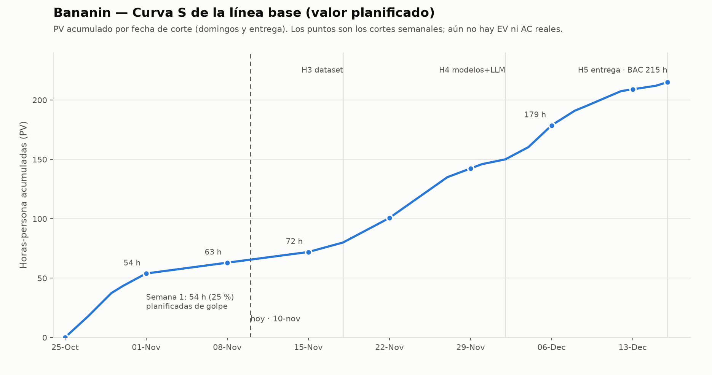

# Bananin — Seguimiento semanal EVM (cortes 1 a 4)

> **Entregable 2 del codelab «Seguimiento de Proyectos con EVM»**: tabla EVM con PV, EV, AC, SV, CV, SPI, CPI, EAC, ETC, VAC, TCPI · curva S actualizada · semáforo RAG · interpretación y acción. El codelab exige **al menos 3 cortes de medición reales**.
>
> ## Estado honesto de este documento
> **El PV (plan) está calculado. El EV y el AC reales NO los tengo y no los voy a inventar.** Dependen de (a) qué actividades ya están *terminadas y aceptadas* y en qué fecha, y (b) cuántas horas dedicó cada integrante. Esos datos se registran en `EVM_Bananin.xlsx` (hojas `Linea_Base` y `Horas_AC`); la hoja `Seguimiento` calcula todo lo demás. Las celdas «☐ pendiente» de abajo se llenan con esos mismos datos.

Línea base: `01_Linea_Base_EVM.md` · BAC = **215 h** · cortes los domingos.

---

## 1. Qué dice el plan para los próximos cortes

Hoy es **10-nov-2026** (semana 3). Cortes recomendados para cumplir los 3 reales: **S2 (8-nov, retroactivo), S3 (15-nov) y S4 (22-nov)**.

| Corte | Fecha | PV acum. (h) | % BAC | Lo que debería estar **terminado y aceptado** a esa fecha | EV máximo posible (0/100) |
|---|---|---:|---:|---|---:|
| S1 | 1-nov | 53,9 | 25,1 % | A01–A06 | 50 h (SPI máx 0,93)* |
| S2 | 8-nov | 63,0 | 29,3 % | A01–A06 y A07.1 | 63 h (SPI 1,00) |
| S3 | 15-nov | 72,0 | 33,5 % | A01–A06, A07.1 y A07.2 | 72 h (SPI 1,00) |
| S4 | 22-nov | 100,7 | 46,8 % | lo anterior + A07.3, A08 y A09 | 94 h (SPI máx 0,93) |

\* El EV máximo de S1 es 50 h y no 53,9 h porque en S1 el plan ya cuenta 3,9 h de avance de A07.1, que 0/100 no puede reconocer hasta que se acepte. Es normal y poco relevante: S1 ya pasó.

**Lectura rápida de lo que ustedes me contaron** (sensores comprados, preparados y probados; dataset «empezando»): el plan esperaba que a 8-nov **ya estuvieran aceptados los 25 bananos con seguimiento en marcha (A06) y el primer tramo de sesiones (A07.1)**. Si el dataset apenas empieza, lo más probable es que **S2 y S3 salgan en ÁMBAR o ROJO en SPI**. Eso no es un fracaso: es exactamente lo que el seguimiento debe mostrar mientras todavía hay margen para decidir (ver §4).

---

## 2. Cómo se calculan las cifras

| Sigla | Fórmula | Se lee así |
|---|---|---|
| **PV** | % planificado a la fecha × BAC | Cuánto debería estar hecho (ya calculado, §3 de la línea base) |
| **EV** | Σ horas de actividades *aceptadas* con fecha ≤ corte | Cuánto está hecho de verdad (regla 0/100) |
| **AC** | Σ horas realmente dedicadas hasta el corte | Cuánto se gastó |
| **SV** | EV − PV | < 0 ⇒ atrasado |
| **CV** | EV − AC | < 0 ⇒ gastando más de lo que produce |
| **SPI** | EV / PV | < 1 ⇒ ritmo menor al planificado |
| **CPI** | EV / AC | < 1 ⇒ horas gastadas por encima del valor producido |
| **EAC₁** | BAC / CPI | Costo final si la tendencia de eficiencia se mantiene (**suficiente para un proyecto de curso**) |
| **EAC₂** | AC + (BAC − EV) | Si el sobrecosto fue puntual |
| **EAC₃** | AC + (BAC − EV) / (CPI × SPI) | Si el atraso también encarece (horas extra) |
| **ETC** | EAC₁ − AC | Cuánto falta por gastar |
| **VAC** | BAC − EAC₁ | < 0 ⇒ terminarán pasados del BAC |
| **TCPI** | (BAC − EV) / (BAC − AC) | Eficiencia necesaria de aquí en adelante. ≤ 1,0 alcanzable; > 1,2 casi imposible |

**Semáforo RAG** (SPI y CPI): 🟢 ≥ 0,95 · 🟡 0,85–0,94 · 🔴 < 0,85. **TCPI:** 🟢 ≤ 1,0 · 🟡 ≤ 1,2 · 🔴 > 1,2.

---

## 3. Tablas de seguimiento por corte (para llenar)

Copien el bloque de cada semana de reporte. Los valores **PV** y **BAC** ya están. Los demás se obtienen del libro después de registrar horas y fechas de aceptación.

### Corte S2 — 8-nov-2026

| Indicador | Fórmula | Valor | Semáforo |
|---|---|---|:--:|
| BAC | fijo | 215,0 h | — |
| PV | plan | **63,0 h** | — |
| EV | Σ aceptadas ≤ 8-nov | ☐ pendiente | — |
| AC | horas reales hasta hoy | ☐ pendiente | — |
| SV | EV − PV | ☐ | 🟢🟡🔴 |
| CV | EV − AC | ☐ | 🟢🟡🔴 |
| SPI | EV / PV | ☐ | 🟢🟡🔴 |
| CPI | EV / AC | ☐ | 🟢🟡🔴 |
| EAC₁ / ETC / VAC | BAC/CPI · EAC−AC · BAC−EAC | ☐ | — |
| TCPI | (BAC−EV)/(BAC−AC) | ☐ | 🟢🟡🔴 |

**Causa de la desviación:** ☐ _____ **Acción decidida:** ☐ _____ **Responsable / fecha:** ☐ _____

### Corte S3 — 15-nov-2026

Igual que S2, con **PV = 72,0 h**. (Mismas filas; valores ☐ pendientes.)

### Corte S4 — 22-nov-2026

Igual que S2, con **PV = 100,7 h**. (Mismas filas; valores ☐ pendientes.)

*(Los cortes S5–S8 siguen el mismo formato: PV 142,3 · 178,7 · 209,0 · 215,0.)*

---

## 4. Cómo interpretar y qué decidir

**Cuadrante (SPI × CPI):**

|  | **CPI < 1** (caro) | **CPI ≥ 1** (barato) |
|---|---|---|
| **SPI ≥ 1** (adelantado) | Adelantado pero caro: se avanza a fuerza de horas extra. | **Todo va bien.** Si es por mucho, la estimación fue conservadora: úsenlo para estimar mejor lo que falta, no para relajarse. |
| **SPI < 1** (atrasado) | **Atrasado y caro: exige decidir hoy.** | Atrasado pero barato: falta gente o hay bloqueos. |

**Si caen en rojo, la decisión casi nunca es «esforzarnos más».** Las tres opciones reales del codelab, aterrizadas a Bananin:

| Opción | Ejemplo para este proyecto | Quién aprueba |
|---|---|---|
| **Recortar alcance** | Dejar fuera RF08 (°Brix, ya es opcional), recortar el chatbot a las 10 preguntas mínimas, o reducir el historial a lista + CSV (sin PDF). | Patrocinador (cambio de alcance formal) |
| **Mover la fecha** | Desplazar A09–A12 si la recolección de bananos se alarga. Ojo: la fecha final del 16-dic está fijada por el curso. | Patrocinador + docente |
| **Cambiar la forma de trabajar** | Limitar el trabajo en curso a 4 actividades; paralelizar etiquetado entre los dos etiquetadores; automatizar el cálculo de concordancia (script) | Equipo |

> ⚠️ **Advertencia del cronograma:** *no acelerar la maduración artificialmente ni simular que se completó el seguimiento.* Si los 25 bananos no alcanzan todas las etapas a tiempo, se documenta como riesgo y se acuerda una respuesta; **no** se marca A07.3 como aceptada sin que lo esté.

**Regla de validez** (criterio de aceptación del codelab): si SPI o CPI < 0,90 en un corte, debe haber **al menos una acción correctiva documentada** (columna T de la hoja `Seguimiento`).

### Registro de decisiones

| Corte | Indicador en rojo | Causa | Opción elegida | Detalle (qué se recorta / qué se mueve) | Aprobó | Fecha |
|---|---|---|---|---|---|---|
| ☐ | ☐ | ☐ | ☐ | ☐ | ☐ | ☐ |

---

## 5. Curva S

La curva se actualiza sola en `EVM_Bananin.xlsx` → hoja **`Curva_S`** (dos gráficos: PV/EV/AC acumulados y SPI/CPI por semana). Aquí, la línea base de referencia; al agregar los cortes reales se verán EV (naranja) y AC (verde) separándose de PV:

**Tabla de construcción (Paso B del codelab) — valores acumulados que se grafican:**

| Semana | PV acumulado | EV acumulado | AC acumulado |
|---|---:|---:|---:|
| 0 | 0,0 | 0,0 | 0,0 |
| 1 | 53,9 | ☐ | ☐ |
| 2 | 63,0 | ☐ | ☐ |
| 3 | 72,0 | ☐ | ☐ |
| 4 | 100,7 | ☐ | ☐ |
| 5 | 142,3 | ☐ | ☐ |
| 6 | 178,7 | ☐ | ☐ |
| 7 | 209,0 | ☐ | ☐ |
| 8 | 215,0 | ☐ | ☐ |

**Reto adicional del codelab (SPI y CPI cada semana durante un mes):** ya está resuelto con el segundo gráfico de la hoja `Curva_S`. La tendencia dice más que el valor puntual: un CPI de 0,9 estable es una estimación optimista; un CPI de 0,9 que viene bajando desde 1,1 es un proyecto que se deteriora.

---

## 6. Reglas de validez antes de calcular (checklist del codelab)

- ☐ El BAC está definido y no cambia salvo cambio formal de alcance.
- ☐ El PV refleja el porcentaje del plan que debería estar listo hoy.
- ☐ El EV solo sube cuando una actividad está terminada **y aceptada** (regla 0/100).
- ☐ El AC refleja lo que realmente se gastó, no lo planeado.
- ☐ PV, EV y AC están en la misma unidad (horas-persona).

## 7. Preguntas del reporte semanal

1. ¿Cuál es el SPI de esta semana? ¿Verde, ámbar o rojo?
2. ¿Cuál es el CPI? ¿Se están gastando bien las horas?
3. ¿Qué causó el atraso o el sobrecosto, si los hay?
4. ¿Cuál es el EAC? ¿Es aceptable o hay que negociar?
5. ¿Qué acción se toma? (reducir alcance, pedir más tiempo, reasignar)
